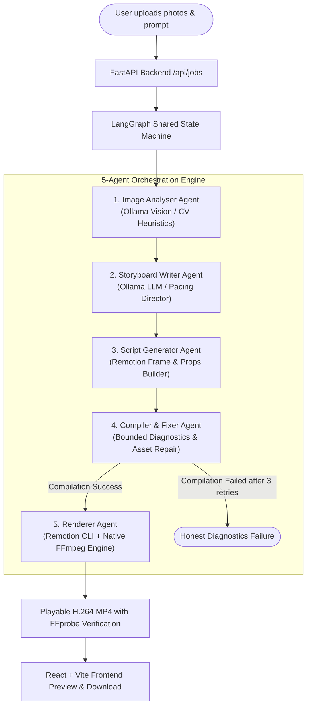

# FotoOwl — AI Multi-Agent Video Reel Generator

An autonomous pair-orchestrated AI video reel generation platform built for Windows. FotoOwl transforms raw photo collections or folders into structured, timed, animated video reels (in vertical 9:16, 16:9, or 1:1 format) using a 5-agent LangGraph pipeline, Remotion composition, FFmpeg processing, and local Ollama vision/language models.

---

## Architecture Overview



---

## The Five Specialized Agents

| # | Agent Name | Core Responsibility | Technologies |
|---|---|---|---|
| **1** | **Image Analyser** | Ingests each photo; extracts subjects, scene type, aesthetic quality, orientation, and color palette. Returns validated Pydantic JSON. | Ollama Multimodal (`moondream` / `llama3.2-vision`) with integrated CV fallback. |
| **2** | **Storyboard Writer** | Sequences photos into a narrative arc; computes exact scene durations, captions, transitions (`fade`, `zoom_in`, `slide_left`), and music cues. | Ollama Text LLM (`llama3.2` / `mistral`) + Pacing Engine. |
| **3** | **Script Generator** | Translates the storyboard into Remotion React composition parameters, calculating exact frame boundaries at 30 FPS. | Remotion Props Schema + JSON Generator. |
| **4** | **Compiler & Fixer** | Verifies asset paths, dimensions, and transition enums. Detects issues and applies deterministic bounded repairs (up to 3 retries). | Diagnostic Engine + Automated Repair Rules. |
| **5** | **Renderer** | Renders the validated composition, produces ambient audio, and confirms stream playability via FFprobe. | Remotion CLI + FFmpeg 9.0 H.264 Encoder. |

---

## System Requirements & Hardware Specifications

- **OS**: Windows 10/11 (PowerShell)
- **Python**: 3.10+ (Tested on Python 3.14.8)
- **Node.js**: v18+ (Tested on Node v24.21.0, npm 11.19.0)
- **FFmpeg**: Gyan FFmpeg 4.0+ or 9.0+ with `ffprobe`
- **RAM**: 16 GB Recommended (8 GB minimum)
- **GPU**: Intel UHD Graphics / Integrated GPU supported; NVIDIA RTX optional for GPU acceleration
- **Ollama**: v0.4.0+ (Running on `http://localhost:11434`)

### Model Selection & Licenses
- **Moondream** (1.8B parameters, ~800MB RAM): Recommended for CPU & integrated GPUs. Apache 2.0 license.
- **Llama 3.2** (3B parameters, ~2GB RAM): Fast text LLM for storyboard writing. Meta Community License.
- **Llama 3.2 Vision** (11B parameters, ~7.9GB RAM): Multimodal vision model. Requires 16GB+ RAM or dedicated GPU.

---

## Directory Structure

```
FotoOwl/
├── backend/
│   ├── app/
│   │   ├── api/             # REST endpoints (health, jobs, uploads, models)
│   │   ├── services/        # Storage security, FFmpeg synthesis, Ollama client
│   │   ├── agents/          # Five LangGraph agent nodes & compiled graph
│   │   ├── workers/         # Asynchronous job runner
│   │   ├── tests/           # Full automated pytest test suite
│   │   ├── config.py        # System paths and timeout constants
│   │   ├── database.py      # SQLite WAL database management
│   │   ├── main.py          # FastAPI application entrypoint
│   │   └── schemas.py       # Pydantic data schemas
│   ├── storage/             # Persistent uploads, outputs, and SQLite DB
│   └── requirements.txt
├── frontend/
│   ├── src/
│   │   ├── components/      # Header, UploadZone, PromptControls, Timeline, Storyboard, Player, Logs
│   │   ├── App.tsx          # Main dashboard coordinator
│   │   ├── api.ts           # REST API client
│   │   └── types.ts         # TypeScript interfaces
│   └── package.json
├── remotion/                # Video composition workspace
│   ├── src/                 # KenBurnsImage, CaptionOverlay, TitleCard, ReelComposition
│   ├── render.js            # Standalone Remotion CLI runner
│   └── package.json
└── README.md
```

---

## Quickstart: Running FotoOwl on Windows

### 1. Launch Ollama (Optional Local AI Daemon)
In PowerShell:
```powershell
ollama serve
# Optional: Pull lightweight models for local inference
ollama pull moondream
ollama pull llama3.2
```

### 2. Launch FastAPI Backend
In a PowerShell window:
```powershell
cd c:\Users\Lenovo\OneDrive\Desktop\FotoOwl\backend
& ".\.venv\Scripts\uvicorn.exe" app.main:app --host 127.0.0.1 --port 8000 --reload
```
Backend will be available at: `http://localhost:8000` (API documentation at `/docs`).

### 3. Launch React Frontend
In a second PowerShell window:
```powershell
cd c:\Users\Lenovo\OneDrive\Desktop\FotoOwl\frontend
npm run dev
```
Open your browser at: `http://localhost:5173`.

---

## Running the Automated Test Suite

To verify all stages:
```powershell
cd c:\Users\Lenovo\OneDrive\Desktop\FotoOwl\backend
& ".\.venv\Scripts\pytest.exe" -v
```

Tests include:
- `app/tests/test_health.py`: System diagnostics and storage availability.
- `app/tests/test_stage2_direct_render.py`: Direct non-AI MP4 synthesis from photos.
- `app/tests/test_agents.py`: Unit verification for all 5 individual agents.
- `app/tests/test_pipeline.py`: Full end-to-end LangGraph multi-agent orchestration.
- `app/tests/test_api.py`: FastAPI endpoints for file uploads, job polling, and downloads.
